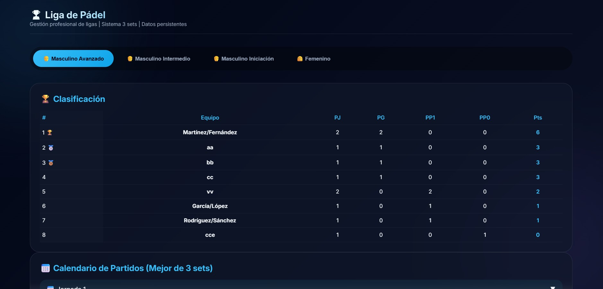
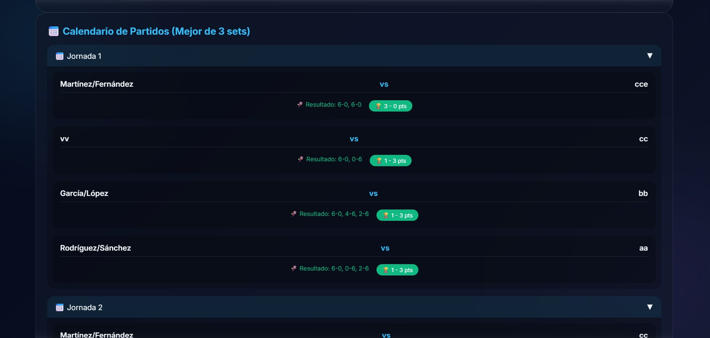
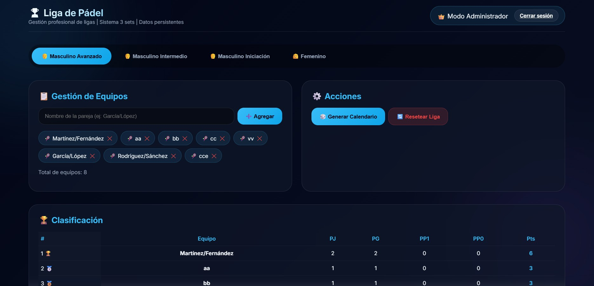
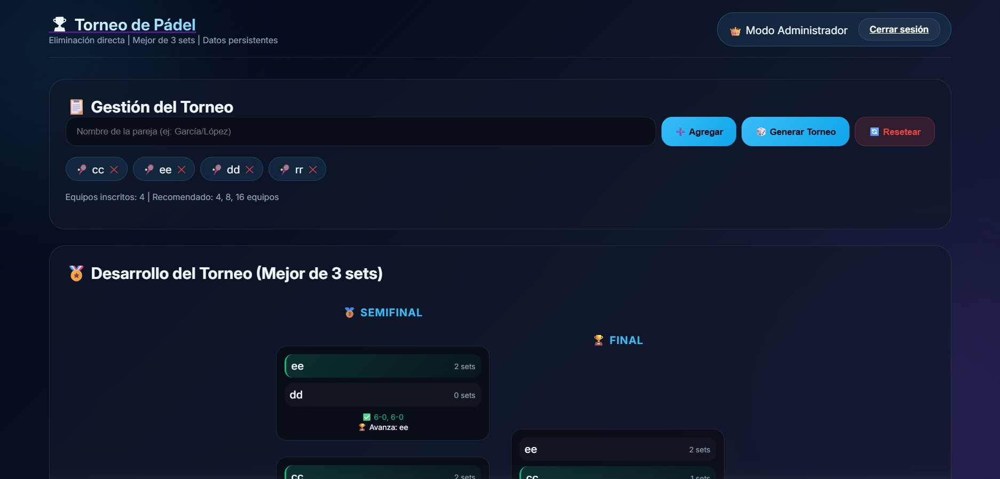

# 🏆 Liga de Pádel - Gestión de Torneos y Ligas

<div align="center">
  
  
  
  
  
  
  
</div>

## 📋 Descripción

Aplicación web completa para la **gestión profesional de ligas y torneos de pádel**. Permite administrar múltiples ligas, generar calendarios automáticos (round-robin), registrar resultados con sistema de puntuación 3/1/0, y organizar torneos de eliminación directa con sorteo aleatorio.

El frontend es HTML/CSS/JavaScript estático y el backend es una API serverless en **Cloudflare Pages Functions** con base de datos **Cloudflare D1** (SQLite).
<br>

### 🎯 Características Principales

- ✅ **4 ligas simultáneas**: Masculino Avanzado, Masculino Intermedio, Masculino Iniciación y Femenino
- ✅ **CRUD completo de equipos**: Añadir, renombrar y eliminar parejas fácilmente
- ✅ **Calendario automático**: Sistema round-robin (todos contra todos)
- ✅ **Resultados al mejor de 3 sets**: Registro detallado por set, validado en cliente y servidor
- ✅ **Corrección de resultados**: Los resultados se pueden corregir o anular (en el torneo, mientras el ganador no haya jugado la ronda siguiente)
- ✅ **Sistema de puntuación 3/1/0**: Victoria 3 pts, Derrota 2-1 → 1 pt, Derrota 2-0 → 0 pts
- ✅ **Clasificación automática**: Ordenada por puntos con estadísticas
- ✅ **Torneo eliminación directa**: Octavos → Cuartos → Semifinal → Final
- ✅ **Sorteo aleatorio con descansos**: Admite cualquier número de equipos; los descansos avanzan automáticamente
- ✅ **Árbol visual del torneo**: Muestra todas las rondas
- ✅ **Login seguro**: Contraseña verificada en el servidor, token firmado con caducidad y límite de intentos
- ✅ **Persistencia de datos**: Base de datos Cloudflare D1
- ✅ **Diseño responsive**: Adaptado a móviles, tablets y ordenadores
- ✅ **Glassmorphism moderno**: Efectos visuales atractivos
<br>

## 🚀 Demo

> **URL de producción:** [https://padel-app-401.pages.dev](https://padel-app-401.pages.dev)

| Rol | Usuario | Contraseña |
|-----|---------|------------|
| Administrador | - | `*****` |
| Público | - | Sin autenticación |
<br>

## 📸 Capturas de Pantalla

<div align="center">
  
| Página Principal | Liga |
|:---:|:---:|
|  |  |

| Torneo | Calendario |
|:---:|:---:|
|  |  |

| Gestión de Liga | Gestión de torneos |
|:---:|:---:|
|  |  |

</div>
<br>

## 🛠️ Tecnologías Utilizadas

| Tecnología | Uso |
|------------|-----|
| HTML5 | Estructura de la aplicación |
| CSS3 | Diseño, animaciones, responsive |
| JavaScript (ES6) | Lógica frontend, peticiones a la API |
| Cloudflare Pages | Hosting del frontend |
| Cloudflare Pages Functions | API serverless (`/api/*`) |
| Cloudflare D1 | Base de datos SQLite |
| Wrangler | CLI de despliegue y desarrollo local |
| Git | Control de versiones |

## 📁 Estructura del Proyecto

```text
padel_app/
|
├──📄 index.html              # Página principal (login + navegación)
├──📄 liga.html               # Gestión de ligas
├──📄 torneo.html             # Gestión de torneos
|
├──📁 js/
|   ├──📄 api.js              # Sesión, llamadas a la API y validación (compartido)
|   ├──📄 index.js
|   ├──📄 liga.js
|   └──📄 torneo.js
|
├──📁 css/
|   ├──📄 index.css
|   ├──📄 liga.css
|   └──📄 torneo.css
|
├──📁 functions/
|   └──📁 api/
|       └──📄 [[path]].js     # API: /api/login, /api/liga, /api/torneo
|
├──📁 img/                    # Capturas de pantalla
├──📁 migrations/             # Migraciones de la base de datos D1 (se aplican en orden)
|   ├──📄 0001_esquema_inicial.sql
|   ├──📄 0002_equipos_por_id.sql
|   └──📄 0003_login_intentos.sql
|
├──📄 wrangler.toml           # Configuración de Cloudflare
└──📄 README.md               # Documentación
```
<br>

## 🗄️ Base de Datos

El esquema se gestiona con las migraciones de la carpeta [`migrations/`](migrations/). Los partidos referencian a los equipos por **id**, así que una pareja se puede renombrar sin perder sus resultados.

| Tabla | Descripción |
|-------|-------------|
| `liga_equipos` | Equipos participantes en cada liga |
| `liga_calendario` | Partidos y resultados de las ligas (`local_id`, `visitante_id`) |
| `torneo` | Torneo actual y su estado |
| `torneo_equipos` | Equipos inscritos en el torneo |
| `torneo_partidos` | Partidos del torneo por rondas (`equipo1_id`, `equipo2_id`, `ganador_id`) |
| `login_intentos` | Intentos fallidos de login por IP |

La clasificación de la liga y el campeón del torneo no se guardan: se calculan a partir de los resultados, por lo que siempre son coherentes al corregir o anular un partido.
<br>

## 🔌 API

Todas las rutas devuelven JSON con la forma `{ success, data?, error? }`.

| Ruta | Acción | Método | Admin |
|------|--------|--------|:-----:|
| `/api/login` | — | POST | — |
| `/api/liga` | `getEquipos`, `getCalendario` | GET | ❌ |
| `/api/liga` | `addEquipo`, `renameEquipo`, `deleteEquipo`, `generarCalendario`, `guardarResultado`, `anularResultado`, `resetLiga` | POST | ✅ |
| `/api/torneo` | `getTorneo` | GET | ❌ |
| `/api/torneo` | `addEquipo`, `renameEquipo`, `deleteEquipo`, `crearTorneo`, `guardarPartido`, `anularPartido`, `resetTorneo` | POST | ✅ |

La acción se indica con `?action=...`. Las acciones de administrador requieren la cabecera `Authorization: Bearer <token>` obtenida en `/api/login`. `guardarResultado` y `guardarPartido` sirven tanto para registrar un resultado como para corregirlo.

Tras **5 intentos fallidos** de login en 15 minutos, la IP queda bloqueada 15 minutos (respuesta `429` con cabecera `Retry-After`).
<br>

## 🛠️ Instalación y Configuración

### Requisitos Previos

- [Node.js](https://nodejs.org/) 18 o superior
- Una cuenta de [Cloudflare](https://dash.cloudflare.com/) (para desplegar)

### Desarrollo Local

```bash
# 1. Clonar el repositorio
git clone https://github.com/ignaciozagea/padel_app.git
cd padel_app

# 2. Crear las tablas en la base de datos local
npx wrangler d1 migrations apply padel-db --local

# 3. Definir la contraseña de administrador para desarrollo
echo "ADMIN_PASSWORD=tu_contraseña" > .dev.vars

# 4. Arrancar el servidor local (frontend + API + D1)
npx wrangler pages dev
# Abrir http://localhost:8788
```

> ⚠️ No subas `.dev.vars` al repositorio.

### Despliegue en Cloudflare

```bash
# 1. Crear la base de datos (solo la primera vez) y poner su id en wrangler.toml
npx wrangler d1 create padel-db

# 2. Hacer una copia de seguridad y aplicar las migraciones pendientes
npx wrangler d1 export padel-db --remote --output=backup.sql
npx wrangler d1 migrations apply padel-db --remote

# 3. Configurar la contraseña de administrador como secreto
npx wrangler pages secret put ADMIN_PASSWORD

# 4. Desplegar
npx wrangler pages deploy
```

> ℹ️ La migración `0002` convierte los datos existentes (nombres → ids) sin perderlos. De paso recalcula los puntos de los partidos de liga ya jugados a partir de sus sets, fusiona equipos duplicados y vuelve a crear los equipos que se borraron teniendo partidos.

También se puede desplegar conectando el repositorio de GitHub a Cloudflare Pages; en ese caso configura el binding D1 `DB` y la variable secreta `ADMIN_PASSWORD` desde el panel del proyecto.
<br>

### 🔐 Seguridad
- ✅ **Autenticación en el servidor**: la contraseña se guarda como secreto de Cloudflare (`ADMIN_PASSWORD`), nunca en el código
- ✅ **Token firmado (HMAC-SHA256)**: caduca a las 8 horas; se guarda en `sessionStorage`
- ✅ **Límite de intentos**: 5 fallos de login en 15 minutos bloquean la IP durante 15 minutos
- ✅ **Acciones protegidas**: toda modificación de datos exige token válido y método POST
- ✅ **Validación**: nombres, ligas y resultados se validan en el servidor
- ✅ **Prepared Statements**: protección contra SQL injection
- ✅ **Escapado de HTML**: protección frente a XSS en nombres de equipos
<br>

## 👤 Autor

**Ignacio Zamora Gea**

- GitHub: [@ignaciozagea](https://github.com/ignaciozagea)
- Demo: [https://padel-app-401.pages.dev](https://padel-app-401.pages.dev)
